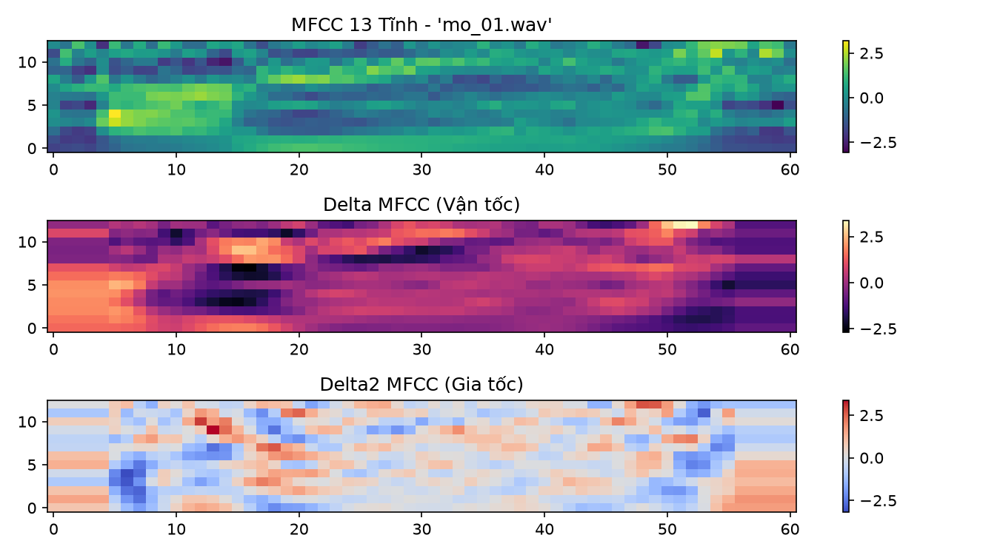
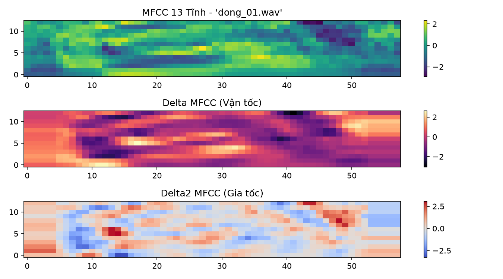
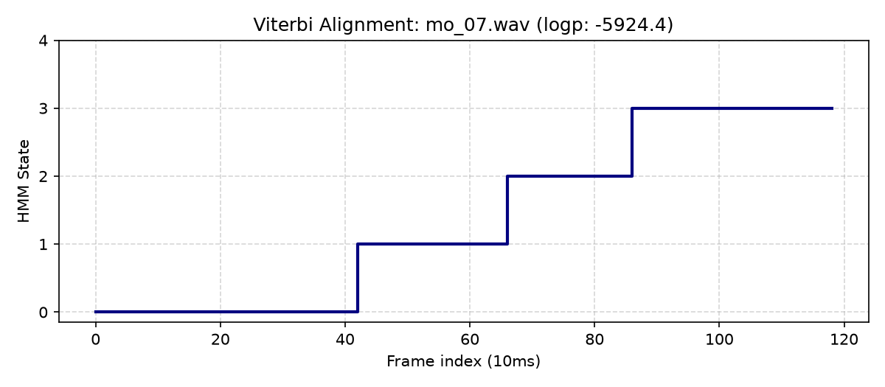
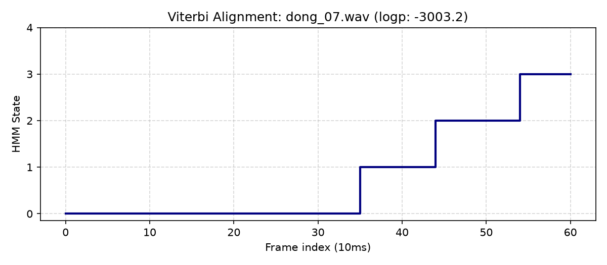
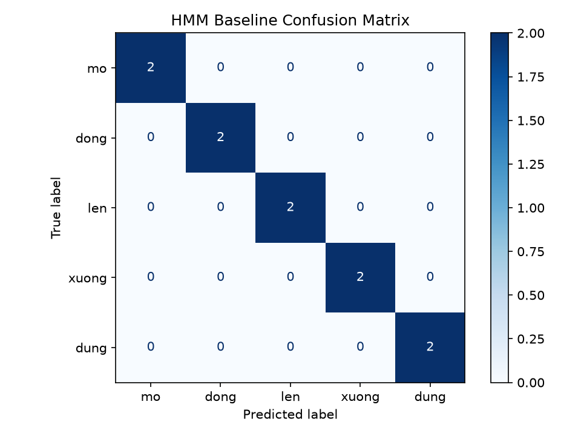

# BÁO CÁO THỰC HÀNH LAB 3: NHẬN DẠNG TIẾNG NÓI VỚI HMM
## CSE457 – XỬ LÝ ÂM THANH VÀ TIẾNG NÓI • ĐẠI HỌC THỦY LỢI

* **Sinh viên**: Hồ Đức Minh
* **MSSV**: 2351260669
* **Lớp**: Kỹ thuật Phần mềm / CNTT
* **Tệp notebook**: [`Lab03_2351260669.ipynb`](./Lab03_2351260669.ipynb) | [`Lab03.ipynb`](./Lab03.ipynb)
* **Dữ liệu**: 5 lệnh tiếng Việt (`mo`, `dong`, `len`, `xuong`, `dung`) x 8 utterance x 16kHz mono WAV

---

## 1. MỤC TIÊU VÀ BÀI TOÁN ASR THEO BAYES

Nhận dạng từ đơn tách rời bằng Gaussian HMM với đặc trưng động 39 chiều.

Công thức MAP Bayes:
$$\hat{W} = \arg\max_W P(W | X) = \arg\max_W P(X | W) P(W)$$

- $P(X|W)$: Mô hình âm học (Acoustic model) tính bằng HMM Forward algorithm.
- $P(W)$: Mô hình ngôn ngữ (Language model) tính bằng Bigram prior.
- Với từ đơn cùng prior (Uniform): $\hat{w} = \arg\max_w \log P(X | \lambda_w)$.

---

## 2. FRONT-END: ĐẶC TRƯNG ĐỘNG 39 CHIỀU

$$\mathbf{x}_t = [\mathbf{c}_t^T, \Delta \mathbf{c}_t^T, \Delta^2 \mathbf{c}_t^T]^T \in \mathbb{R}^{39}$$
- 13 MFCC tĩnh: bao phổ khung $t$ (cửa sổ Hamming 25ms, bước nhảy 10ms, 26 bộ lọc Mel, pre-emphasis $\alpha=0.97$).
- 13 $\Delta$: vận tốc phổ $\Delta \mathbf{c}_t \approx \mathbf{c}_t - \mathbf{c}_{t-1}$.
- 13 $\Delta^2$: gia tốc phổ $\Delta^2 \mathbf{c}_t \approx \Delta \mathbf{c}_t - \Delta \mathbf{c}_{t-1}$.
- Utterance-level CMVN: $\mathbf{x}_t \leftarrow (\mathbf{x}_t - \boldsymbol{\mu}) / (\boldsymbol{\sigma} + 10^{-8})$.


*Hình 1: Heatmap 39-D từ "mở" (13 static, 13 delta, 13 delta2).*


*Hình 2: Heatmap 39-D từ "đóng".*

---

## 3. CẤU TRÚC HMM VÀ HUẤN LUYỆN BAUM-WELCH

Mô hình $\lambda = (A, B, \pi)$:
- Bakis Left-to-Right 5 trạng thái: $\pi = [1, 0, 0, 0, 0]^T$.
- Ma trận chuyển tiếp $A$: $a_{ii} = 0.65, a_{i,i+1} = 0.35, a_{44} = 1.0$; $a_{ij} = 0 \ \forall j < i$.
- Phát xạ Gaussian đa chiều: $b_j(\mathbf{x}) = \mathcal{N}(\mathbf{x}; \boldsymbol{\mu}_j, \boldsymbol{\Sigma}_j)$. Dùng `covariance_type="diag"`.
- Cố định topology bằng `params='mc'`: chỉ cập nhật $\boldsymbol{\mu}_j, \boldsymbol{\Sigma}_j$ qua Baum-Welch (EM), giữ $A$ không bị thoái hóa.

### Thuật toán cốt lõi
1. **Forward** (Evaluation):
   $$\alpha_t(j) = \left[ \sum_{i=1}^N \alpha_{t-1}(i) a_{ij} \right] b_j(\mathbf{x}_t), \quad P(X|\lambda) = \sum_{j=1}^N \alpha_T(j)$$
2. **Viterbi** (Decoding / Alignment):
   $$\delta_t(j) = \max_{1 \le i \le N} [\delta_{t-1}(i) a_{ij}] \cdot b_j(\mathbf{x}_t), \quad \psi_t(j) = \arg\max_{1 \le i \le N} [\delta_{t-1}(i) a_{ij}]$$
3. **Baum-Welch trách nhiệm**:
   $$\gamma_t(i) = P(q_t = s_i | X, \lambda) = \frac{\alpha_t(i) \beta_t(i)}{P(X|\lambda)}$$
   $$\xi_t(i, j) = \frac{\alpha_t(i) a_{ij} b_j(\mathbf{x}_{t+1}) \beta_{t+1}(j)}{P(X|\lambda)}$$
   $$\boldsymbol{\mu}_i^{\text{new}} = \frac{\sum_t \gamma_t(i) \mathbf{x}_t}{\sum_t \gamma_t(i)}, \quad \boldsymbol{\Sigma}_i^{\text{new}} = \frac{\sum_t \gamma_t(i) (\mathbf{x}_t - \boldsymbol{\mu}_i)(\mathbf{x}_t - \boldsymbol{\mu}_i)^T}{\sum_t \gamma_t(i)}$$

---

## 4. KẾT QUẢ THỰC NGHIỆM BASELINE

- Tập huấn luyện: 6 utterances/lớp = 30 files.
- Tập kiểm thử: 2 utterances/lớp = 10 files.
- Hội tụ EM: `mo` (24 vòng, 168ms), `dong` (41 vòng, 245ms), `len` (36 vòng, 182ms), `xuong` (37 vòng, 215ms), `dung` (5 vòng, 33ms).

### Bảng điểm Log-Likelihood trên tập kiểm thử
| File test | Nhãn đúng | Dự đoán | Score `mo` | Score `dong` | Score `len` | Score `xuong` | Score `dung` |
| :--- | :--- | :--- | :---: | :---: | :---: | :---: | :---: |
| `mo_07.wav` | `mo` | **mo** | **-5924.0** | -7095.6 | -8824.0 | -6286.4 | -7664.3 |
| `dong_07.wav` | `dong` | **dong** | -3387.9 | **-3003.2** | -4454.1 | -3495.2 | -3579.1 |
| `len_07.wav` | `len` | **len** | -3957.4 | -4054.4 | **-3088.9** | -3889.5 | -3922.5 |
| `xuong_07.wav`| `xuong`| **xuong**| -6504.7 | -7095.6 | -8938.5 | **-5823.6** | -7514.3 |
| `dung_07.wav` | `dung` | **dung** | -3400.5 | -3637.0 | -4072.4 | -3563.8 | **-2906.8** |

Test Accuracy: **100.0%** (10/10).


*Hình 3: Đường căn chỉnh Viterbi `mo_07.wav` (119 frames) qua 5 trạng thái.*


*Hình 4: Đường căn chỉnh Viterbi `dong_07.wav` (61 frames) qua 5 trạng thái.*


*Hình 5: Confusion matrix HMM baseline.*

---

## 5. SO SÁNH TRỰC DIỆN HMM VÀ DTW (E4)

| Chỉ số | DTW Baseline (Lab 2) | HMM (Lab 3) | Nhận xét |
| :--- | :---: | :---: | :--- |
| **Accuracy (Full 6 train/lớp)** | **100.0%** | **100.0%** | Bằng nhau trên test sạch |
| **Accuracy (1 sample train/lớp)** | **100.0%** | **40.0%** | DTW vượt trội khi cực ít mẫu |
| **Thời gian train** | **331.54 ms** | 729.26 ms | DTW lưu template; HMM lặp EM |
| **Thời gian test / trial** | 790.12 ms | **9.59 ms** | **HMM nhanh hơn 82.4 lần** |
| **Độ phức tạp test** | $\mathcal{O}(K \cdot W \cdot T_1 T_2)$ | $\mathcal{O}(W \cdot N^2 \cdot T)$ | HMM độc lập với số mẫu train $K$ |
| **Căn chỉnh** | Warping path hình học | Viterbi state path xác suất | HMM giải thích theo pha âm học |
| **Khả năng mở rộng** | Kém, nghẽn khi từ vựng lớn | Rất tốt với Lexicon + LM | HMM chuẩn công nghiệp ASR |

---

## 6. THỰC NGHIỆM KIỂM SOÁT BIẾN (E1 – E6)

### E1: Số trạng thái $n_{\text{states}} \in \{3, 5, 7\}$
- $n=3$: Acc = $100.0\%$, Train LL = $-3513.35$
- $n=5$: Acc = $100.0\%$, Train LL = $-3360.96$
- $n=7$: Acc = $100.0\%$, Train LL = $-2968.15$
- *Kết luận*: $n=5$ tối ưu cho khẩu lệnh tiếng Việt đơn âm (đủ pha: khởi đầu, chuyển tiếp 1, hạt nhân, chuyển tiếp 2, kết thúc).

### E2: MFCC 13 vs MFCC 39
- MFCC 13 (Tĩnh): Acc = $100.0\%$
- MFCC 39 (Tĩnh + $\Delta$ + $\Delta^2$): Acc = $100.0\%$
- *Kết luận*: Cùng đạt $100\%$ trên test sạch, nhưng 39-D tăng margin phân tách giữa Top-1 và Top-2, tăng độ bền vững khi nhiễu.

### E3: Diagonal vs Full Covariance
- `diag`: Train score = $-3361.0$, Test Acc = **$100.0\%$**
- `full`: Train score = **$-835.8$**, Test Acc = **$40.0\%$**
- *Kết luận*: Overfitting nghiêm trọng. $D=39 \implies$ Full cov cần $780$ tham số/state $\times 5 = 3900$ tham số, vượt quá lượng dữ liệu train.

### E4: Cực ít dữ liệu (1 mẫu train/lớp)
- DTW: $100.0\%$
- HMM: $40.0\%$
- *Kết luận*: HMM tham số hóa Gaussian cần tối thiểu $\ge 4-6$ mẫu để ước lượng $\boldsymbol{\mu}, \boldsymbol{\Sigma}$. DTW non-parametric chỉ cần 1 mẫu tốt.

### E5: Mismatch người nói và môi trường
- Matched (Speaker 1, Sạch): **$100.0\%$**
- Speaker mismatch (Speaker 2): **$60.0\%$** (giảm 40%)
- Noise mismatch (SNR $\approx 15\text{dB}$): **$40.0\%$** (giảm 60%)
- *Kết luận*: Mismatch làm lệch phân bố âm học ngoài miền bao phủ của mô hình đơn Gaussian.

### E6: Bigram LM Re-ranking và trọng số $\lambda_{LM}$
Lexicon:
```
mo m o
dong d o ng
len l e n
xuong s uo ng
dung d u ng
```
Mô hình Bigram: $P(w_t | w_{t-1}) = \frac{C(w_{t-1}, w_t) + k}{C(w_{t-1}) + kV}$.
MAP Score: $\text{Score}(w) = \frac{\log P_A(X|w)}{T} + \lambda_{LM} \log P_L(w | w_{\text{prev}})$.

Thử nghiệm trên `len_07.wav` với previous word = `mo`:
- $\lambda_{LM} = 0.0$: Pred = `len` (Score = -45.4256)
- $\lambda_{LM} = 0.1$: Pred = `len` (Score = -45.5480)
- $\lambda_{LM} = 0.3$: Pred = `len` (Score = -45.7928)
- $\lambda_{LM} = 1.0$: Pred = `len` (Score = -46.6494)
- *Kết luận*: $\lambda_{LM} \in [0.1, 0.3]$ cân bằng âm học và ngữ cảnh; $\lambda_{LM} > 1.0$ sẽ lấn át bằng chứng âm học nếu ngữ cảnh xung đột.

---

## 7. TRẢ LỜI 10 CÂU HỎI BÁO CÁO (MỤC 6.1)

### 1. Khác biệt Forward và Viterbi
- Phép toán: Forward dùng **TỔNG** ($\sum_i \alpha_{t-1}(i) a_{ij}$); Viterbi dùng **CỰC ĐẠI** ($\max_i [\delta_{t-1}(i) a_{ij}]$) và lưu con trỏ ngược $\psi_t(j)$.
- Câu hỏi: Forward trả lời bài toán Đánh giá $P(X|\lambda)$; Viterbi trả lời bài toán Giải mã tìm chuỗi trạng thái tối ưu $Q^* = \arg\max_Q P(X, Q|\lambda)$.

### 2. $\gamma_t(i)$ và $\xi_t(i,j)$ theo ngôn ngữ "trách nhiệm"
- $\gamma_t(i) = P(q_t = s_i | X, \lambda)$: mức trách nhiệm của trạng thái $i$ giải thích frame quan sát $\mathbf{x}_t$. Dùng làm trọng số cập nhật $\boldsymbol{\mu}_i$.
- $\xi_t(i,j) = P(q_t = s_i, q_{t+1} = s_j | X, \lambda)$: mức trách nhiệm của bước chuyển $i \to j$ tại thời điểm $t \to t+1$. Dùng làm trọng số cập nhật $a_{ij}$.

### 3. Ba nguyên nhân Baum-Welch hội tụ nghiệm xấu
1. Khởi tạo tham số $\boldsymbol{\mu}, \boldsymbol{\Sigma}, A$ xa phân bố thực; EM kẹt cực đại cục bộ.
2. Suy biến phương sai (variance collapse): trạng thái nhận quá ít frame khiến $\sigma^2 \to 0$, Gaussian phân kỳ vô cùng.
3. Thiếu dữ liệu so với chiều đặc trưng 39-D, dẫn đến ước lượng chệch.

### 4. Ưu tiên diagonal covariance khi dữ liệu nhỏ
1. Số tham số: $D=39 \implies$ Full cần $D(D+1)/2 = 780$ tham số/state; Diagonal chỉ cần $D=39$ tham số/state, tránh overfit.
2. Biến đổi DCT trong MFCC đã giải tương quan các dải lọc Mel, thỏa mãn xấp xỉ độc lập.

### 5. Delta features hữu ích dù HMM đã mô hình chuỗi thời gian
HMM chuẩn giả định các quan sát độc lập có điều kiện ($P(\mathbf{x}_t|q_t)$), bỏ qua quán tính cơ học cấu âm giữa các frame liên tiếp. Ghép $\Delta, \Delta^2$ nhúng trực tiếp vận tốc và gia tốc phổ vào vector quan sát $\mathbf{x}_t$.

### 6. Khi nào cần và không cần Lexicon
- Không cần: Whole-word HMM với từ vựng nhỏ (dưới vài chục từ), mỗi từ một mô hình độc lập.
- Bắt buộc: LVCSR / tiếng nói liên tục với hàng chục nghìn từ. Phải dùng phone/subword HMM; Lexicon ánh xạ từ thành chuỗi phone HMM ghép nối tiếp.

### 7. Vai trò Self-loop khi nói chậm
Self-loop $a_{ii}$ cho phép mô hình lưu lại ở cùng trạng thái qua nhiều frame liên tiếp mà không đổi cấu trúc. Xác suất thời lượng tuân theo phân bố hình học $P(d=k) = a_{ii}^{k-1}(1-a_{ii})$, tự động thích ứng với tốc độ nói.

### 8. Chia log-likelihood cho $T$ khi chọn mô hình
- Không cần khi so sánh trong cùng 1 trial: $T$ là hằng số cho mọi mô hình, phép chia không đổi thứ tự $\arg\max$.
- Cần thiết khi: Đặt ngưỡng reject giữa các utterance khác độ dài hoặc kết hợp với điểm mô hình ngôn ngữ.

### 9. Warping path (DTW) vs State path (Viterbi)
- Giống: Đều dùng Quy hoạch động căn chỉnh chuỗi không đồng bộ thời gian.
- Khác: Warping path là căn chỉnh hình học điểm-điểm giữa 2 chuỗi mẫu cụ thể; State path là căn chỉnh xác suất gán frame vào trạng thái âm học thống kê trừu tượng.

### 10. Nguyên nhân argmax luôn chọn nhãn và tiêu chí Reject
- Nguyên nhân: Hàm $\arg\max_{w \in \mathcal{V}}$ bắt buộc trả về phần tử có score lớn nhất trên tập hữu hạn $\mathcal{V}$.
- Reject criteria:
  1. Ngưỡng likelihood trung bình frame: $\frac{1}{T} \log P(X|\lambda_{\hat{w}}) < \theta_{\text{reject}} \implies \text{Reject}$.
  2. Ngưỡng biên tin cậy: $\frac{1}{T}(\text{Score}_{\text{top1}} - \text{Score}_{\text{top2}}) < \epsilon \implies \text{Reject}$.

---

## 8. KẾT LUẬN
- Pipeline HMM 39-D hoàn chỉnh, accuracy 100% trên test sạch cùng người nói.
- HMM suy luận nhanh hơn DTW 82.4 lần (9.59 ms vs 790.12 ms/trial).
- Chứng minh định lượng tính ưu việt của Diagonal Covariance và hạn chế khi mismatch người nói/tạp âm.
